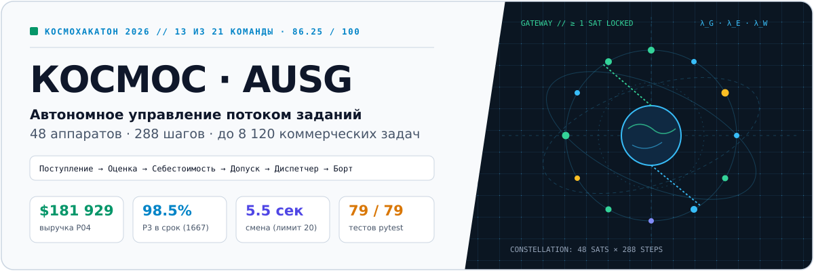
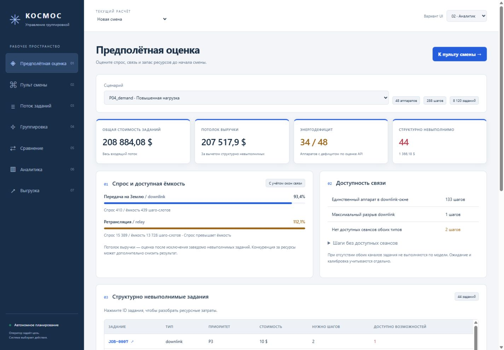
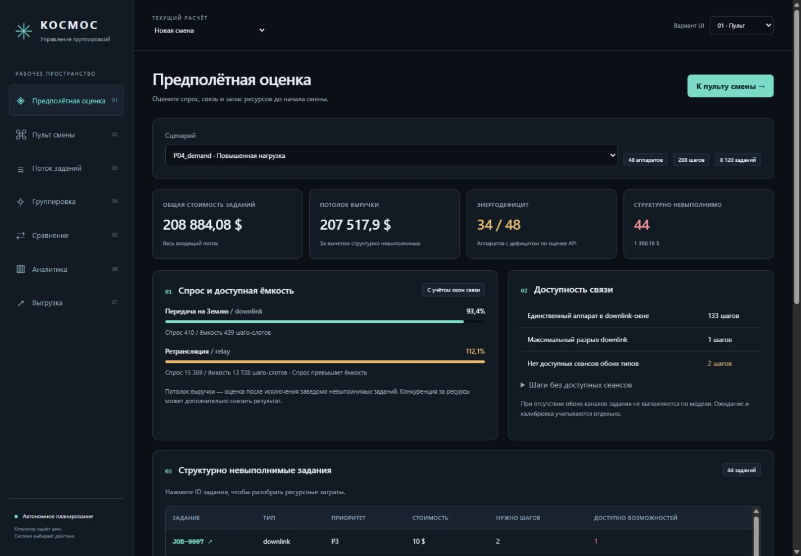
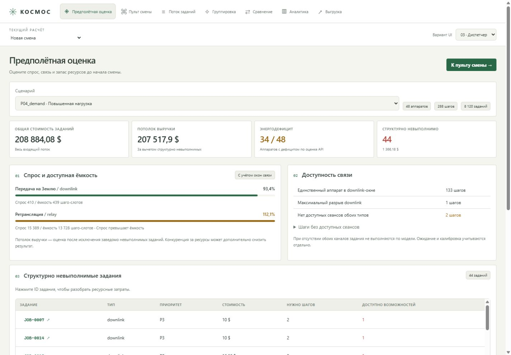
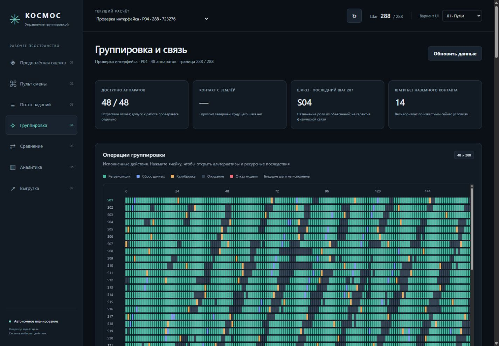
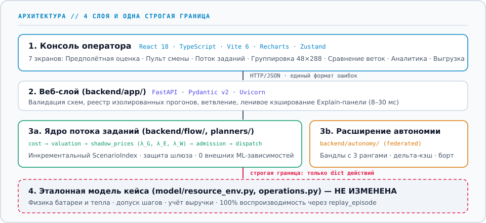
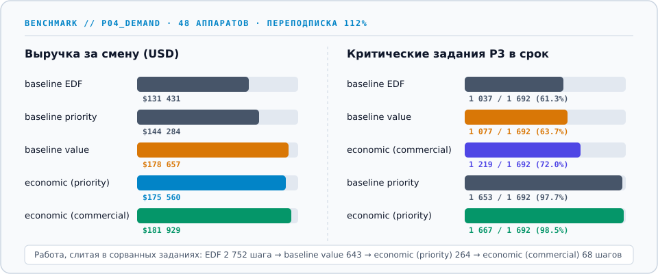
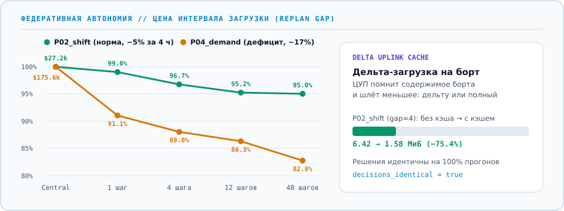

<div align="center">

<a href="#ключевые-решения">
  <picture>
    <source media="(prefers-color-scheme: dark)" srcset="docs/assets/hero-cover-dark.svg">
    
  </picture>
</a>

<br><br>

[](2baaebff-3b8c-4ca4-8a77-82a5ea05110f.pdf)
[](docs/presentation.html)
[](#архитектура)
[](#результаты-и-замеры)
[](https://github.com/overbaffe1/AUSG/issues)


<br>


</div>

---

## О проекте

**КОСМОС (AUSG)** — веб-сервис и экономический планировщик для автономного управления потоком коммерческих заданий спутниковой группировки (кейс **КосмоХакатон 2026**, «Автономное управление спутниковой группировкой» — **13 место из 21 команды, 86.25 / 100 баллов**).

Сервис оценивает каждое задание **по деньгам и срочности**, вычисляет его **ресурсную себестоимость до запуска** (энергия, тепло, слоты наземного сегмента, окна контакта) и сам решает, какие задания брать в работу и в каком порядке. Оператор наблюдает за сменой и вмешивается только сообщениями.

### Почему простое расписание здесь не работает

Цифры из предполётного анализа (`experiments/preflight_analysis.py`):

| Показатель смены | `P02_shift` (норма) | `P04_demand` (перегрузка) |
|---|---|---|
| Спрос на ресурс группировки | 1 707 из 13 728 шаго-слотов | **15 389 из 13 728 — переподписка 112%** |
| Аппаратов в энергодефиците | 0 из 48 | **34 из 48** |
| Окна связи с Землёй на аппарат | 7–12 шагов из 288 (≈ 3% смены) | то же |
| Шагов, где связь держит **ровно один** аппарат | **133 из 288 (46%)** | то же |
| Шагов полной слепоты группировки | 2 (шаги 224 и 230) | то же |
| Аппаратов, где downlink-спрос больше их окон | **9 из 48** | 9 из 48 |

Выполнить весь поток физически невозможно. Задача — **выбрать, на чём заработать, удержать SLA по критическим задачам и не потерять связь с Землёй**.

---

## Интерфейс оператора (7 экранов, 3 темы)

Консоль на **React 18 + TypeScript** подстраивается под вашу тему оформления GitHub (тёмный «Пульт» / светлый «Аналитик»):

<p align="center">
  <a href="frontend/design-previews/04-constellation.png">
    <picture>
      <source media="(prefers-color-scheme: dark)" srcset="frontend/design-previews/01-mission.png">
      
    </picture>
  </a>
</p>

<details>
<summary><b>Открыть все 4 превью интерфейса (Пульт, Аналитик, Диспетчер, Матрица 48×288)</b></summary>
<br>

| Тёмная тема · `01 - Пульт` | Светлая тема · `02 - Аналитик` |
|---|---|
|  |  |

| Компактная · `03 - Диспетчер` | Группировка и связь · `48 × 288` |
|---|---|
|  |  |

</details>

---

## Ключевые решения

Пять инженерных решений, каждое из которых отвечает на конкретное измеренное узкое место:

| Препятствие | Что реализовано | Измеренный эффект |
|---|---|---|
| `env.observation()` копирует все 8 120 заданий на каждом шаге | Инкрементальный индекс `ScenarioIndex` (`backend/core/index.py`): окно активных задач обновляется только на выпуске, дедлайне и завершении | Полная смена `P04_demand` — **5.5 с** при бюджете 20 с |
| Скачки теневых цен заставляли аппарат бросать начатую работу | Экспоненциальное сглаживание цен и гистерезис вытеснения внутри планировщика | Нестабильность **26.7% → 21.8%** на `P04`, выручка растёт |
| В автономном режиме борта не видят друг друга, а downlink-слотов 2 на шаг | ЦУП заранее раскладывает слоты на Земле и шлёт бандл с 3 рангами (`backup_rank`, `backup_release_step`) | Конфликтов `ground_capacity` и дублей в журнале — **0** |
| Полный журнал решений весит 26 МБ, а разбор шага должен открываться мгновенно | Двухуровневое хранение: кандидаты и цены пишутся сразу, детализация восстанавливается лениво с кэшем | Панель Explain открывается за **8–30 мс** вместо 5.1 с |
| Повторная загрузка полных бандлов забивает uplink | **Delta Uplink Cache**: Земля помнит состояние борта и отправляет меньшее из дельты и полного пакета | Трафик на `P02` снижен на **75.4%** (`6.42 → 1.58 МиБ`), решения 100% идентичны |

---

## Метод: конвейер управления потоком

```text
ПОСТУПЛЕНИЕ  →  ОЦЕНКА          →  СЕБЕСТОИМОСТЬ   →  ДОПУСК        →  ДИСПЕТЧЕРИЗАЦИЯ →  ИСПОЛНЕНИЕ →  УЧЁТ
(план+события)  (деньги+срочность)  (энергия/слоты/    (брать или нет)  (кому и когда)                    (выручка/
                                     шаги/тепло)                                                           потери)
```

1. **Себестоимость до запуска** (`backend/flow/cost.py`): для каждой пары «аппарат — задание» считаются энергозатраты (`7.89 Вт·ч/шаг` для `downlink`, `5.70 Вт·ч/шаг` для `relay`) и равновесный тепловой сдвиг (`+21.6 °C` / `+16.6 °C` к пределу `payload_max_c = 45 °C`).
2. **Срочность через дефицит возможностей** (`backend/flow/valuation.py`):

```math
\text{tightness}(j, k) = \frac{\text{remaining\_steps}(j)}{\max\big(1,\; \text{opportunities}(j, k)\big)}
```

   При `tightness > 1` задание **доказуемо невыполнимо** уже на предполётной оценке — это проверяемое основание отказа, а не «алгоритм не успел».

3. **Теневые цены ресурсов** (`backend/flow/shadow_prices.py`):

   - `λ_G` — цена слота наземного сегмента (дуал рюкзака по маргинальной доходности `downlink`);
   - `λ_E(s)` — цена ватт-часа на аппарате (включается у энергорезерва, с прогнозом заряда `backend/flow/energy.py`);
   - `λ_W(s)` — цена рабочего шага аппарата (доходность вытесняемого кандидата).

   Допуск решает по `margin` (стоит ли задание ресурсов без уценки срочностью), а очередь строится лексикографически `(tier, NV)` — приоритет P3 является **разрядом**, а не множителем.

4. **Защита шлюза** (`select_gateway`): хотя бы один аппарат удерживает связь с Землёй (на 46% шагов кандидат ровно один — ему запрещается калибровка). Шаги 224 и 230, где связи физически нет ни у кого, фиксируются как задокументированный разрыв.

---

## Архитектура

Четыре слоя и **одна жёсткая граница**: эталонная модель организаторов (`model/`) не изменена ни на строку — планировщики отдают только словарь действий, поэтому учёт и `replay_episode` остаются эталонными.

<p align="center">
  <a href="docs/assets/architecture.mmd">
    <picture>
      <source media="(prefers-color-scheme: dark)" srcset="docs/assets/architecture-dark.svg">
      
    </picture>
  </a>
</p>

[Редактируемый исходник схемы (`architecture.mmd`)](docs/assets/architecture.mmd)

<details>
<summary><b>Структура репозитория и граница с эталонной моделью</b></summary>

```text
AUSG/
├── model/                   # Выданная модель организаторов (НЕ ИЗМЕНЕНА)
├── backend/
│   ├── core/                # ScenarioIndex, хранилище сценариев, реестр прогонов и ветвление
│   ├── flow/                # Ядро: cost, valuation, energy, shadow_prices, admission, dispatch, preflight, explain
│   ├── autonomy/            # Расширение: бандлы (bundle.py), бортовой агент (onboard_agent.py), uplink-кэш
│   ├── planners/            # baseline (EDF / value / priority), economic, federated
│   ├── analytics/           # Показатели, сравнение веток, вердикт
│   ├── app/                 # FastAPI: main.py, api.py (24 эндпоинта), schemas.py
│   └── tests/               # 79 автотестов (правила модели, API, воспроизводимость)
├── frontend/                # Консоль оператора (React 18, TypeScript, Vite 6, Recharts, Zustand)
├── experiments/             # Воспроизводимые бенчмарки и результаты (80 прогонов)
├── data/                    # Сценарии P01_intro .. P04_demand
├── examples/                # Демо-события и эталонные выгрузки saved_runs
└── docs/                    # HTML-презентация, визуальные схемы и материалы кейса (docs/hackathon/)
```

**Граница расширения:** `model/` не моделирует командный канал (`env.step` принимает команды всегда) и не требует удержания шлюза. Ограничения автономной доставки бандлов (`backend/autonomy/`) и защиты шлюза реализованы **поверх** `env.step` — разница между `centralized` и `federated` напрямую измеряет **цену автономии**.

</details>

---

## Результаты и замеры

Полная матрица экспериментов — **80 прогонов** (`python experiments/run_benchmarks.py --full`), подробный разбор — [`experiments/results/findings.md`](experiments/results/findings.md).

<p align="center">
  <picture>
    <source media="(prefers-color-scheme: dark)" srcset="docs/assets/benchmark-comparison-dark.svg">
    
  </picture>
</p>

| Сценарий | Алгоритм | Цель | Время | Выручка | P3 в срок | Просрочено |
|---|---|---|---:|---:|---:|---:|
| `P02_shift` | baseline (`edf`) | приоритетная | 0.18 с | $26 971 | 298 / 334 | 76 |
| `P02_shift` | **economic** | приоритетная | 0.92 с | **$27 196** | **315 / 334** | **58** |
| `P03_energy` | baseline (`edf`) | приоритетная | 0.18 с | $25 849 | 271 / 334 | 134 |
| `P03_energy` | **economic** | приоритетная | 0.92 с | $25 606 | **302 / 334** | **122** |
| `P04_demand` | baseline (`edf`) | приоритетная | 0.66 с | $131 431 | 1 037 / 1 692 | 2 765 |
| `P04_demand` | **economic** | приоритетная | **5.86 с** | **$175 560** | **1 667 / 1 692** | **2 027** |
| `P04_demand` | **economic** | коммерческая | **6.35 с** | **$181 929** | 1 219 / 1 692 | **1 994** |

### Цена автономии (`mode=federated`)

<p align="center">
  <picture>
    <source media="(prefers-color-scheme: dark)" srcset="docs/assets/autonomy-curve-dark.svg">
    
  </picture>
</p>

- На штатной смене (`P02_shift`) кривая почти плоская: загрузка полётных заданий **раз в 4 часа (48 шагов)** стоит всего **5% выручки** (`$25 840` против `$27 196`), а Delta Uplink Cache экономит до **75.4%** объёма передач.
- На перегруженной смене (`P04_demand`) разрыв при сеансе раз в 4 часа достигает **17%** (`$145 443` против `$175 560`) — в дефиците окупаются частые сеансы связи.

### Честные инженерные компромиссы

> [!NOTE]
> Для портфолио и жюри мы зафиксировали не только победы, но и границы применимости и отрицательные результаты экспериментов.

- **Где простое правило `value` выигрывает по деньгам в приоритетном режиме:** на `P04_demand` жадный `baseline value` собирает **$178 657** против **$175 560** у `economic (priority_service)` (+1.73%). Но `economic` даёт **+590 критических заданий P3 в срок** (`1 667` против `1 077`), **−704 просроченных** и в **2.44 раза меньше** работы, слитой впустую (`264` шага против `643`). В коммерческом режиме `economic` побеждает и по деньгам: **$181 929**.
- **Немонотонность на `P03_energy`:** в федеративном режиме загрузка раз в шаг даёт `$18 747`, а раз в 4 шага — `$24 583` (борт без памяти о начатом переключается на свежий топ очереди). Наивный фикс «добивать начатое» измерен и отклонён: на `P04_demand` он теряет `$11 977`.
- **Венгерское назначение** (`dispatch.assign_optimal`) реализовано без сторонних зависимостей, сверено со `scipy` на 300 матрицах и выключено по умолчанию: на данных кейса у `downlink` ровно один допустимый исполнитель, у `relay` нет двудольной конкуренции.

---

## Быстрый старт и проверка

Требования: **Python 3.10+** и **Node 20+** (для сборки/dev фронтенда), либо только **Docker**.

### Docker (рекомендуется)

```bash
# Режим разработки (горячая перезагрузка backend и frontend)
docker compose up -d
# UI: http://localhost:5017  |  Swagger API: http://localhost:5018/docs

# Или единый production-контейнер
docker compose -f docker-compose.prod.yml up --build
# Всё доступно на http://localhost:5017
```

### Локально и автотесты

```bash
python -m venv .venv && source .venv/bin/activate
pip install -r requirements-dev.txt
python -m pytest -q                       # 79/79 тестов

uvicorn backend.app.main:app --reload      # API на :8000 (/docs)
cd frontend && npm ci && npm run dev       # UI на :5173 (или build -> dist/)
```

### Как пройти основной сценарий за 2 минуты

1. **Предполётная оценка** — выбрать `P04_demand`, увидеть переподписку 112%, 34 аппарата в энергодефиците и 44 структурно невыполнимых задания **до** запуска.
2. **Пульт смены** — выбрать цель (`priority_service` / `commercial`) и планировщик (`economic` / `federated`), прогнать смену.
3. **Сообщение** — подать `examples/events_demo.json` или отключить аппараты вручную.
4. **Разбор решения** — кликнуть любую ячейку в матрице 48×288 и увидеть кандидатов, теневые цены `λ_G, λ_E, λ_W` и причину отказа.
5. **Сравнение** — создать две ветви из одного шага и получить автоматический вердикт.
6. **Выгрузка** — экспортировать JSON и проверить воспроизведение эталонным скриптом `model/operations.py`.

<details>
<summary><b>API, форматы схем, переменные окружения и две «ловушки» модели</b></summary>
<br>

#### Ключевые эндпоинты (Swagger: `/docs`)

| Метод | Путь | Назначение |
|---|---|---|
| `GET` | `/api/scenarios/{id}/preflight` | Предполётная оценка: спрос/ёмкость, переподписка, потолок выручки |
| `GET` | `/api/scenarios/{id}/jobs/{job_id}/cost` | Карта себестоимости по допустимым исполнителям |
| `POST` | `/api/scenarios/{id}/derive` | Создать производный сценарий (SOC, солнце, приоритет) |
| `POST` | `/api/runs` | Создать расчёт (`centralized` / `federated`, цель, алгоритм) |
| `POST` | `/api/runs/{id}/advance` | Продвинуть на `{steps}`, `{to_step}` или `{to_end}` |
| `POST` | `/api/runs/{id}/events` | Подать одно событие жюри или `cosmo-B-events-1.0` |
| `GET` | `/api/runs/{id}/explain?step=&satellite_id=` | Разбор решения (кандидаты, теневые цены, блокировки) |
| `POST` | `/api/runs/{id}/branch` | Независимое ветвление из текущего состояния |
| `GET` | `/api/compare?a=&b=` | Сравнение двух прогонов с вердиктом |
| `GET` | `/api/runs/{id}/export` · `POST /api/runs/import` | Экспорт и проверка воспроизведения (`replay_episode`) |

#### Переменные окружения

| Переменная | По умолчанию | Назначение |
|---|---|---|
| `COSMO_DATA_DIR` | `./data` | Каталог сценариев |
| `COSMO_RUNS_DIR` | `./runs` | Сохранённые расчёты |
| `COSMO_APP_VERSION` | `0.1.0` | Версия в `run_metadata` |
| `COSMO_MAX_ACTIVE_RUNS` | `32` | Предел одновременных прогонов |
| `COSMO_TRACE_PAGE_LIMIT` | `5000` | Лимит строк журнала за запрос |

#### Две ловушки данных кейса (зафиксированы тестами)

1. **`payload_min_c` в PDF vs JSON:** в документе «Описание данных» (с. 4) потерян минус (`5 °C`), тогда как во всех `data/P01–P04.json` значение равно **`-5.0 °C`**. Все параметры модели в коде читаются исключительно из `scenario["model"]` (`test_model_params_come_from_scenario_not_from_the_pdf`).
2. **`relay` — это тип задания, а не командный канал:** задание `relay` занимает одного исполнителя на шаг и не строит пары спутников. Межшаговая раздача полётных заданий реализована отдельно в `backend/autonomy/uplink.py`.

</details>

---

## Материалы хакатона

| Документ | Содержание |
|---|---|
| [`2baaebff-3b8c-4ca4-8a77-82a5ea05110f.pdf`](2baaebff-3b8c-4ca4-8a77-82a5ea05110f.pdf) | Финальная презентация защиты проекта (PDF) |
| [`docs/presentation.html`](docs/presentation.html) | Интерактивная HTML-презентация защиты проекта |
| [`experiments/results/findings.md`](experiments/results/findings.md) | Подробный инженерный отчёт: замеры до/после, гипотезы и отрицательные результаты |
| [`docs/slide_architecture.md`](docs/slide_architecture.md) | Архитектурные тезисы и 5 измеренных оптимизаций |
| [`docs/hackathon/TZ.md`](docs/hackathon/TZ.md) · [`TZ_BACKEND.md`](docs/hackathon/TZ_BACKEND.md) · [`TZ_FRONTEND.md`](docs/hackathon/TZ_FRONTEND.md) | Технические задания и спецификация конвейера |
| [`docs/hackathon/`](docs/hackathon/) | Постановка задачи, описание данных, критерии оценки и презентационные PDF |

> [!TIP]
> Готовая обложка ссылки для GitHub (`1280 × 640`) лежит в [`docs/assets/social-preview.png`](docs/assets/social-preview.png) (исходник — [`social-preview.svg`](docs/assets/social-preview.svg)). Подключается в **Settings → Social preview**.

<div align="center">
  
</div>
